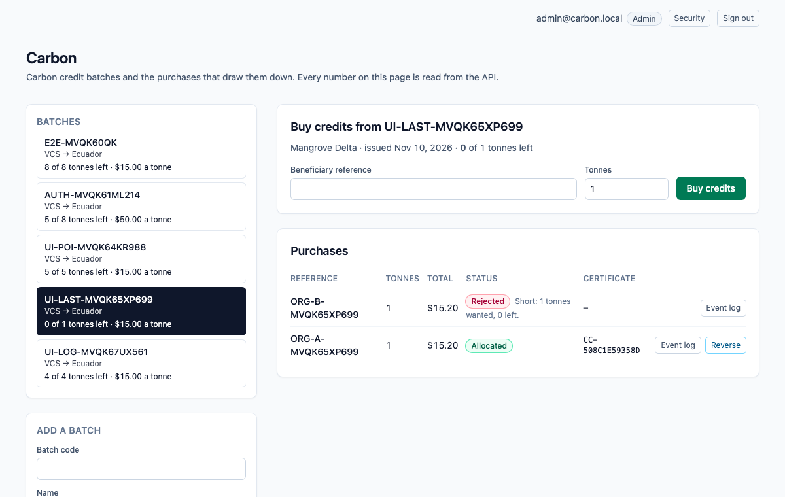
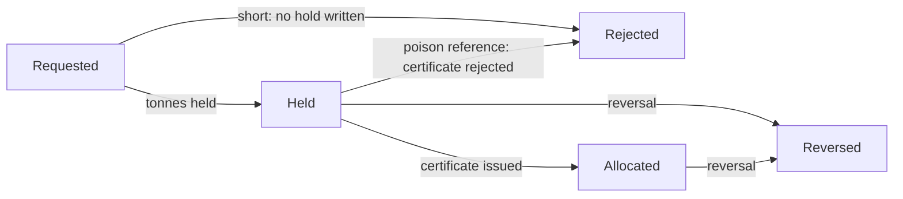
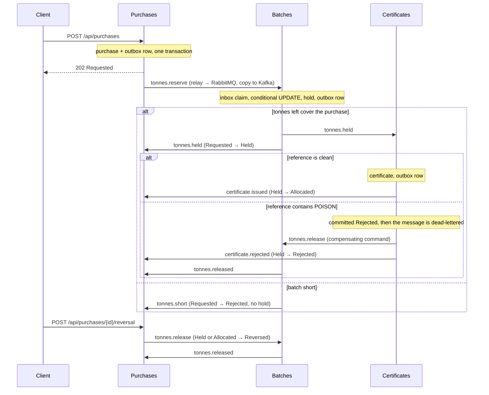

# dotnet-carbon

Carbon credit batches and the purchases that draw them down. The scarce number is the **tonnes left** in a batch (one credit is one tonne of CO2e), and the **Batches** module is its only writer: it holds tonnes with a single conditional `UPDATE` that matches only while the tonnes left still cover the purchase, so when two buyers fight for the last tonne, one commits a hold and the other is told the batch is short and no hold is written. A beneficiary reference that contains the poison token `POISON` is committed as rejected by the Certificates module, the message is dead-lettered, and a compensating command gives the tonnes back. A later reversal also gives the tonnes back to the batch, but it does not roll back the allocation certificate that was already issued.

One ASP.NET Core process, one Postgres database. An HTTP write saves the purchase and an outbox row in one local transaction; a `BackgroundService` relay publishes outbox rows to RabbitMQ (the work queue) and Kafka (the event log); the next module consumes from RabbitMQ, claims an inbox key in the same transaction as its own write, and writes its own row and outbox row. Saga steps never call each other in-process. Delivery is at-least-once: the relay can publish and crash before it marks a row sent, so the row goes out again, and every consumer dedupes with its inbox key. Each saga step only moves a purchase forward from the status it expects.

> The Compose network is local and unauthenticated. There is no login, no token and no cookie. Do not publish these ports; Compose binds all of them to `127.0.0.1`.



*The UI reads everything from the API. Shown: an allocated purchase, a reversal that gave 25 tonnes back and kept its certificate, a purchase rejected for the poison token, and one that was short.*

## What this models, and what it does not

Carbon registries give every credit a serial number and let it be retired once; retirement is what stops two parties from claiming the same tonne, and a retirement certificate records the project, vintage and beneficial owner. Real retirement is irreversible. This repository models the step before it: **allocating** tonnes from a batch to a beneficiary. The scarce-number rule is the same (a tonne can be promised once), and a reversal here stands for removing an allocation before it is retired, for example when a buyer backs out or a batch is invalidated. The certificate is kept as the record of what was issued, which is the behaviour the saga rules require. It does not model serial-number ranges or retirement.

## Money

Prices are whole cents on the batch. A purchase costs tonnes × (the batch's price per tonne plus a flat registry levy of 20 cents per tonne), so 10 tonnes at $15.00 cost $152.00. A purchase is 1 to 500 tonnes. The arithmetic is `checked`: it throws instead of wrapping.

## Purchase statuses



`Reversed` and `Rejected` (after a hold) give the tonnes back through a `ReleaseTonnes` command, and Batches releases a hold at most once. The certificate has its own status (`Issued` or `Rejected`) and a reversal never changes it. If the reversal gets there before the final mark, the late mark finds the purchase is no longer `Held` and does nothing.

## How the modules talk



| Module | Owns | Consumes | Emits |
| --- | --- | --- | --- |
| **Purchases** (`Modules/Purchases`) | `Purchases`: status, tonnes, total, beneficiary reference. Validation, the poison rule, the total. | `tonnes.held`, `tonnes.short`, `certificate.issued`, `certificate.rejected`, `tonnes.released` | `tonnes.reserve`, `tonnes.release` (reversal) |
| **Batches** (`Modules/Batches`) | `Batches.TonnesLeft` (sole writer after the batch opens) and `TonneHolds`. | `tonnes.reserve`, `tonnes.release` (prefetch 1) | `tonnes.held`, `tonnes.short`, `tonnes.released` |
| **Certificates** (`Modules/Certificates`) | `Certificates`. | `tonnes.held` | `certificate.issued`, `certificate.rejected`, `tonnes.release` (poison) |
| **Messaging** (`Messaging`) | `OutboxMessages`, `InboxMessages`, the relay, the consumer loop with retry and dead-letter, the Kafka log. | | |

RabbitMQ topology is declared in code (`Messaging/Topology.cs`): exchange `carbon.work`, one queue per module (`batches.commands`, `certificates.work`, `purchases.events`), a `.retry` queue per module (2 s TTL, then back to the main queue, 3 attempts), and a `.dlq` per module behind `carbon.dlx`. A transient failure retries; a poison message goes straight to the dead-letter queue after its rejection is committed. Kafka has one topic, `carbon.events`, one partition, replication factor 1, keyed by purchase id.

## Run it

Needs Node 22 (npm 10), .NET SDK 10.0.401 (`global.json`), Docker (arm64 is fine) and python3 for the smoke script.

```bash
npm ci
docker compose up -d --wait db        # dotnet test uses Postgres on 5478 (database carbon_test)
dotnet test tests/api/Carbon.Api.Tests.csproj
docker compose up --build --wait      # db, kafka, rabbitmq, api, web
./scripts/smoke.sh                    # last line: carbon smoke passed
npx playwright install chromium       # once
npx playwright test                   # two specs against http://127.0.0.1:8098
docker compose down                   # keeps the Postgres volume; `down -v` drops it
```

| Service | Host port |
| --- | --- |
| Web (nginx, proxies `/api/`) | 8098 |
| API (`/scalar/v1`, `/api/health`) | 5218 |
| Postgres 17 | 5478 |
| Kafka 3.8.1 (KRaft, one broker) | 9128 |
| RabbitMQ 3.13 / management UI (`platform` / `platform`) | 5708 / 15708 |

Inside the Compose network the API and nginx listen on 8080 and Kafka's internal listener is 9092.

## Try it with curl

```bash
curl -s -X POST http://127.0.0.1:5218/api/batches \
  -H 'content-type: application/json' \
  -d '{"code":"MANGROVE-2025","name":"Mangrove Delta","standard":"VCS","country":"Ecuador","tonnesIssued":100,"priceCents":1500}'

curl -s -X POST http://127.0.0.1:5218/api/purchases \
  -H 'content-type: application/json' \
  -d '{"batchCode":"MANGROVE-2025","reference":"ORG-1001","tonnes":10}'
# 202, status Requested, totalCents 15200. Use the returned id:

curl -s http://127.0.0.1:5218/api/purchases/<id>             # Allocated after a few seconds, with a certificate number
curl -s http://127.0.0.1:5218/api/certificates/<id>
curl -s http://127.0.0.1:5218/api/batches/MANGROVE-2025      # tonnesLeft 90
curl -s http://127.0.0.1:5218/api/purchases/<id>/events      # the Kafka log for this purchase

curl -s -X POST http://127.0.0.1:5218/api/purchases/<id>/reversal \
  -H 'content-type: application/json'                        # tonnes go back to the batch; the certificate stays
```

A purchase is validated at the door: beneficiary reference required (at most 40 characters), 1 to 500 tonnes. The poison match is a case-sensitive substring: `ORG-POISON-7` and any longer token containing `POISON` match.

## Develop with Nx

The repository is an Nx workspace (`nx.json`, plugin `@nx/dotnet`). `npx nx show projects` lists `api` (the ASP.NET Core monolith), `web` (the Angular app) and the inferred xUnit project.

```bash
docker compose up -d --wait db kafka rabbitmq   # the brokers and Postgres, not the app
npx nx serve api                                # http://localhost:5218
npx nx serve web                                # http://localhost:4298, proxies /api to the API
WEB_URL=http://localhost:4298 npx playwright test   # the same browser specs, against the dev servers
npx nx run-many -t typecheck lint -p web        # tsc --noEmit and ESLint (angular-eslint)
npx nx build web && npx nx build api            # what CI builds
```

## What is tested, and where it runs

- **xUnit against real Postgres** (`tests/api`, 26 tests): two tasks with two `DbContext`s fight for one remaining tonne (one `Held`, one `Short`, tonnes left 0, no hold for the loser); empty input, over-limit input, integer overflow (4294967297 must not wrap to 1), the total and its checked arithmetic, the poison substring; the same message delivered twice is claimed once; a release returns the tonnes once; the poison rejection is committed before the dead-letter; a reversal followed by the late final mark leaves the purchase `Reversed` and the certificate `Issued`. The race test was run against a read-then-write version of the hold, where it failed, and against the conditional update, where it passes.
- **`scripts/smoke.sh`** drives the composed stack with a run id on every code, so a kept volume does not collide: validation, the happy path (total, certificate, Kafka log), three concurrent purchases for one tonne (one allocated, two short, no hold for the losers), the poison reference (rejected, `certificates.work.dlq` gains one message, tonnes restored), and a reversal that lands between the certificate and the final mark (purchase `Reversed`, certificate `Issued`, tonnes back, second reversal `409`). To make that last window wide enough to hit on purpose, Compose sets `Purchases__FinalMarkDelayMs=1500`; it is a latency knob and defaults to 0.
- **Playwright** (`e2e/specs/buy-credits.spec.ts`): adds a batch in the UI, buys credits, sees `Allocated` and the certificate number, reloads to prove the page reads the API and keeps nothing in `localStorage`, then reverses and sees the tonnes come back. A second spec, `e2e/specs/ui-flows.spec.ts`, drives the page through the refusal messages (over-limit, empty reference, duplicate), the poison rejection, the loser of a race for the last tonne, and the Kafka event log panel. Both specs pass against the Compose stack and against the Nx dev servers.
- **CI** (`.github/workflows/ci.yml`, on push) has two jobs. `verify`: `npm ci`, Prettier check, `dotnet format whitespace --verify-no-changes`, `dotnet test` with a Postgres 17 service, `nx typecheck` and `nx lint` for web (ESLint with angular-eslint, template accessibility rules included, zero warnings allowed), and `nx build` for web and api. `e2e`: builds the Compose stack on the runner, runs `scripts/smoke.sh` and both Playwright specs against it, uploads the Playwright traces and prints the Compose logs on failure.

## API

All routes are unauthenticated JSON. Interactive docs are at `http://127.0.0.1:5218/scalar/v1` (OpenAPI at `/openapi/v1.json`); the web port proxies `/api/`, `/scalar/` and `/openapi/` too.

| Method and path | What it does | Responses |
| --- | --- | --- |
| `GET /api/health` | Liveness. | `200 Healthy` |
| `POST /api/batches` | Opens a batch with its tonnes issued and a price in cents per tonne. | `201`, `400` invalid, `409` code exists |
| `GET /api/batches` | Lists batches. | `200` |
| `GET /api/batches/{code}` | One batch with the live tonnes left. | `200`, `404` |
| `POST /api/purchases` | Accepts a purchase (1 to 500 tonnes) and starts the saga. | `202` Requested, `400` invalid, `404` unknown batch, `409` duplicate reference |
| `GET /api/purchases?batchCode=` | Lists the latest 100 purchases, optionally for one batch. | `200` |
| `GET /api/purchases/{id}` | One purchase and its status. | `200`, `404` |
| `POST /api/purchases/{id}/reversal` | Moves a held or allocated purchase to `Reversed` and gives the tonnes back. The certificate is not touched. | `202`, `404`, `409` wrong status |
| `GET /api/purchases/{id}/events` | The Kafka event log for one purchase, read from the start of the topic. | `200` |
| `GET /api/certificates/{purchaseId}` | The certificate row. | `200`, `404` until the step has run |

Errors come back as `application/problem+json` with a `title`.

## Configuration

Compose sets these on the API container. Defaults in `apps/api/appsettings.json` point at the published host ports, so `nx serve api` works against `docker compose up -d --wait db kafka rabbitmq`.

| Setting | Compose value | Meaning |
| --- | --- | --- |
| `ConnectionStrings__Carbon` | `Host=db;Port=5432;Database=carbon;Username=carbon;Password=carbon` | The one Postgres database. Migrations run on startup. |
| `RabbitMq__Host` / `__Port` / `__User` / `__Password` | `rabbitmq` / `5672` / `platform` / `platform` | Work queue. Virtual host `/`. |
| `Kafka__BootstrapServers` | `kafka:9092` | Event log. |
| `Purchases__FinalMarkDelayMs` | `1500` | Milliseconds the final mark waits. A latency knob so the smoke can land a reversal inside the window. `0` outside Compose. |
| `CARBON_TEST_DB` (tests only) | | Postgres connection for `dotnet test`. Defaults to `localhost:5478`, database `carbon_test`. CI points it at its service container. |

## Look inside and fix things

```bash
docker compose ps                      # five services, all healthy
docker compose logs -f api             # relay, consumers, poison and retry lines
docker compose exec db psql -U carbon -d carbon -c 'select "RoutingKey","SentAt" from "OutboxMessages" order by "Id" desc limit 10'
open http://127.0.0.1:15708            # RabbitMQ management, platform / platform
```

- **Dead-lettered messages** sit in `certificates.work.dlq`. Nothing replays them; inspect them in the management UI. Retries wait in `<queue>.retry` for 2 seconds.
- **A port is already in use**: `lsof -nP -i :5218` shows who holds it. Compose publishes only on `127.0.0.1`.
- **`dotnet test` cannot connect**: start Postgres first with `docker compose up -d --wait db`.
- **The smoke cannot reach the API**: run `docker compose up --build --wait` first; override the target with `API=... RABBIT=... ./scripts/smoke.sh`.
- **Start clean**: `docker compose down -v` drops Postgres, Kafka and RabbitMQ data. Plain `down` keeps them, and the smoke is safe on kept data because every code carries a run id.
- **The Kafka log looks empty right after a purchase**: the relay publishes within a second or so; reload the event log.

## Known limits

- It is unauthenticated on purpose. Anything that can reach the API can read and write everything.
- It models allocation, not retirement or trading: no serial-number ranges, no vintages, no registry accounts, no buffer pool and no payment. The scarce-number mechanics are the point.
- Delivery is at-least-once, not exactly-once. The inbox makes repeats harmless for the saga; the Kafka log can hold a duplicate event after a relay crash.
- One broker, one partition, replication factor 1, one API instance. The relay does not coordinate across instances (the inbox would absorb the duplicates, but the outbox is never trimmed).
- `GET .../events` scans the whole topic for each call. Fine here, not something to expose at scale.
- Lists are capped at 100 rows and not paginated.
- Dead-lettered messages are not replayed automatically.
- The browser specs drive Chromium at a desktop size only, and the `e2e` CI job needs Docker and takes a few minutes.

## Cloud mapping

This repository runs on Compose. Nothing in it calls a cloud account. There is no Pub/Sub client in the process.

| Here | On Google Cloud |
| --- | --- |
| Postgres 17 | Cloud SQL for PostgreSQL |
| Kafka 3.8 | A Pub/Sub topic or managed Kafka |
| RabbitMQ 3.13 | A Pub/Sub subscription with a dead-letter topic |
| The API and the web app | Cloud Run |

## Layout

```
apps/api      ASP.NET Core monolith: Modules/{Purchases,Batches,Certificates}, Messaging, Data, Migrations
apps/web      Angular 21, styled with Tailwind 4 utilities only
tests/api     xUnit against Postgres
e2e/          Playwright
scripts/      smoke.sh
compose.yaml  Postgres, Kafka, RabbitMQ, API, web
```

Nx 23.2.1 orchestrates `nx build web`, `nx lint web`, `nx typecheck web` and `nx build api`; EF Core migrations are committed and the API applies them on startup.

## Other systems in this .NET track

- [dotnet-freight](https://github.com/joshbarros/dotnet-freight): container space on ocean sailings.
- [dotnet-clinic](https://github.com/joshbarros/dotnet-clinic): appointment slots in a provider session.
- [dotnet-ledger](https://github.com/joshbarros/dotnet-ledger): outgoing payments from an account balance.
- [dotnet-warehouse](https://github.com/joshbarros/dotnet-warehouse): warehouse stock and outbound orders.
- [dotnet-academy](https://github.com/joshbarros/dotnet-academy): course cohort seats and enrollments.
- [dotnet-compute](https://github.com/joshbarros/dotnet-compute): GPU-hour reservations in a pool.
- [dotnet-hotel](https://github.com/joshbarros/dotnet-hotel): hotel room-nights.
- [dotnet-tickets](https://github.com/joshbarros/dotnet-tickets): event ticket tiers and orders.
- [dotnet-charging](https://github.com/joshbarros/dotnet-charging): EV charger slot reservations.
- [dotnet-promo](https://github.com/joshbarros/dotnet-promo): limited-use promo codes and redemptions.
